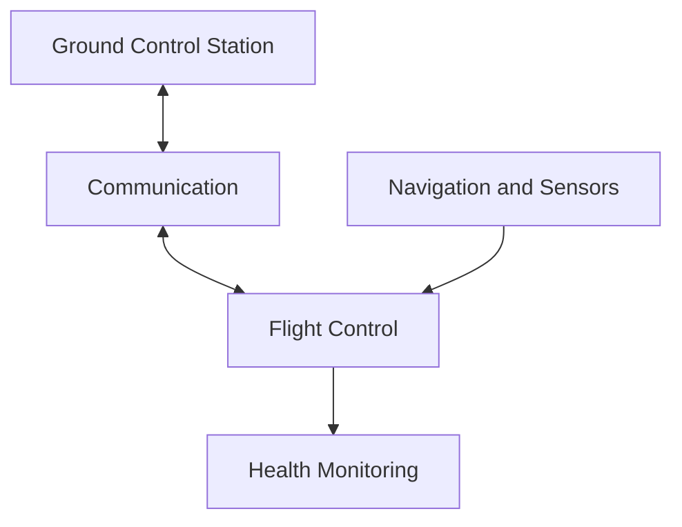

# L02 - UAV Software Integration Block Diagram

**Candidate:** Lakshya Thakur  
**Candidate ID:** TRAIN-004  
**Role:** Systems Integration Engineer  
**Date:** 22 October 2026

## 1. Purpose

This diagram shows the main software modules of a UAV
and how they exchange information.

## 2. Block Diagram

## 3. Simple Explanation

- Ground Control Station: Used by the operator to monitor the UAV.
- Communication: Transfers commands and status information.
- Navigation and Sensors: Provides position and sensor data.
- Flight Control: Processes available inputs for flight-control functions.
- Health Monitoring: Checks available system status.

## 4. Data Flow

The Ground Control Station exchanges information with
the UAV through Communication.

Navigation and Sensors provide data to Flight Control.
Health Monitoring checks the available system status.

## 5. Note

This is a simplified, proposed diagram. The actual
connections must be verified against the UAV project
architecture.
